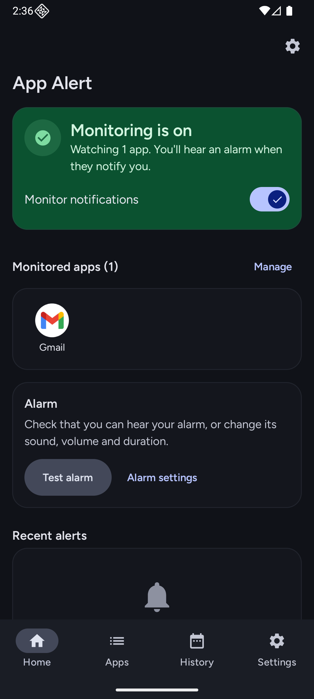
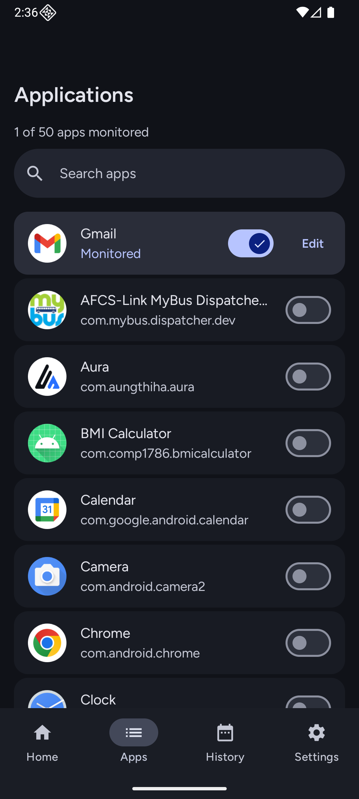
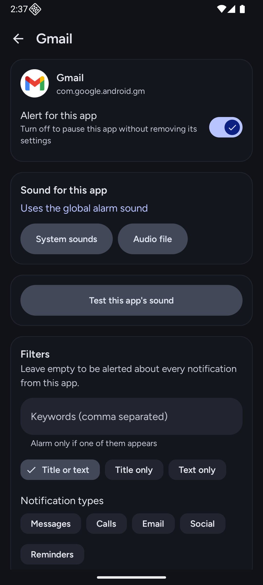
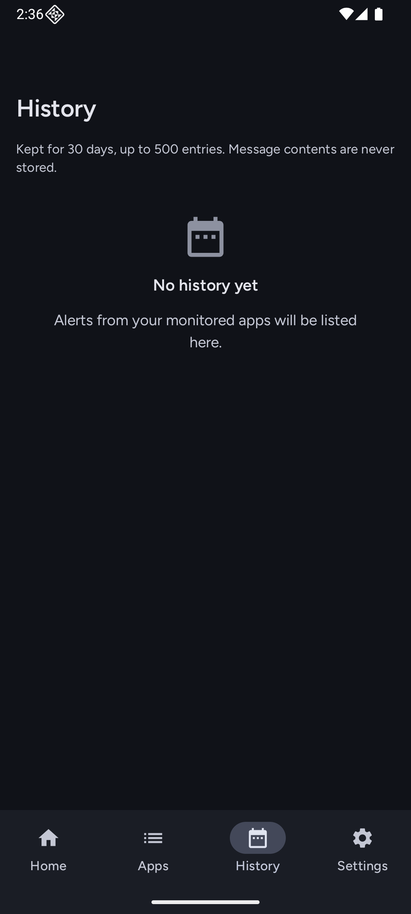
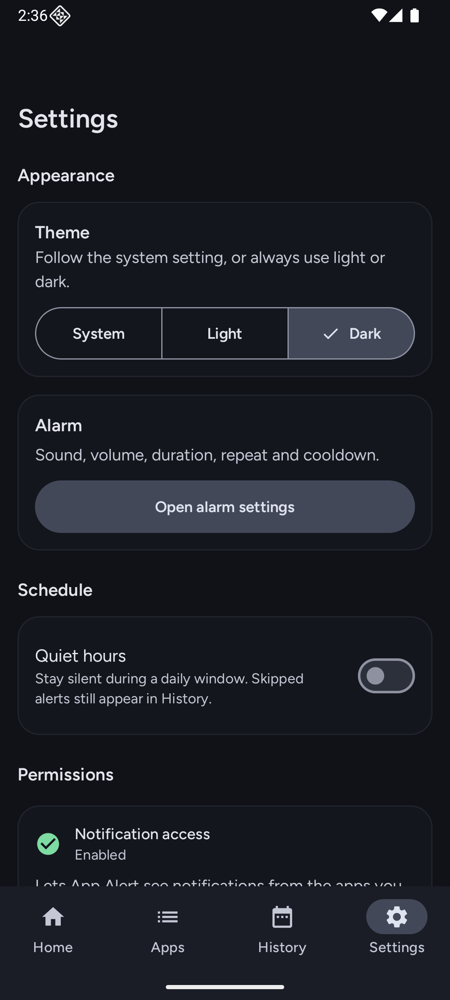
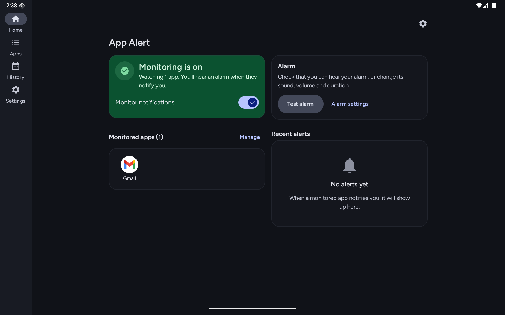
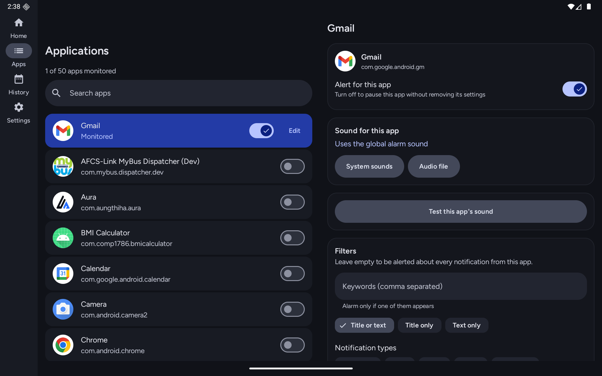
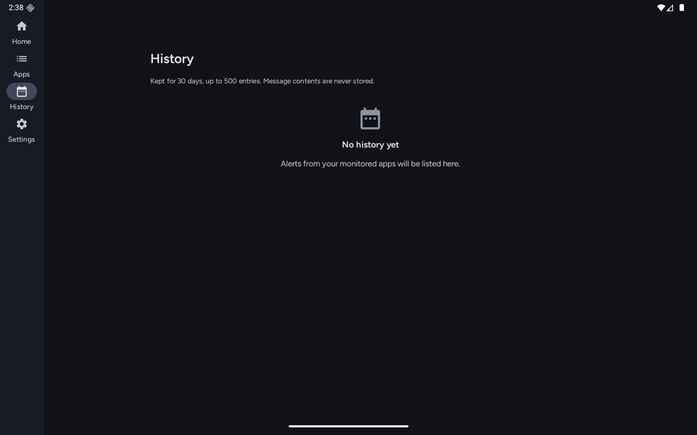
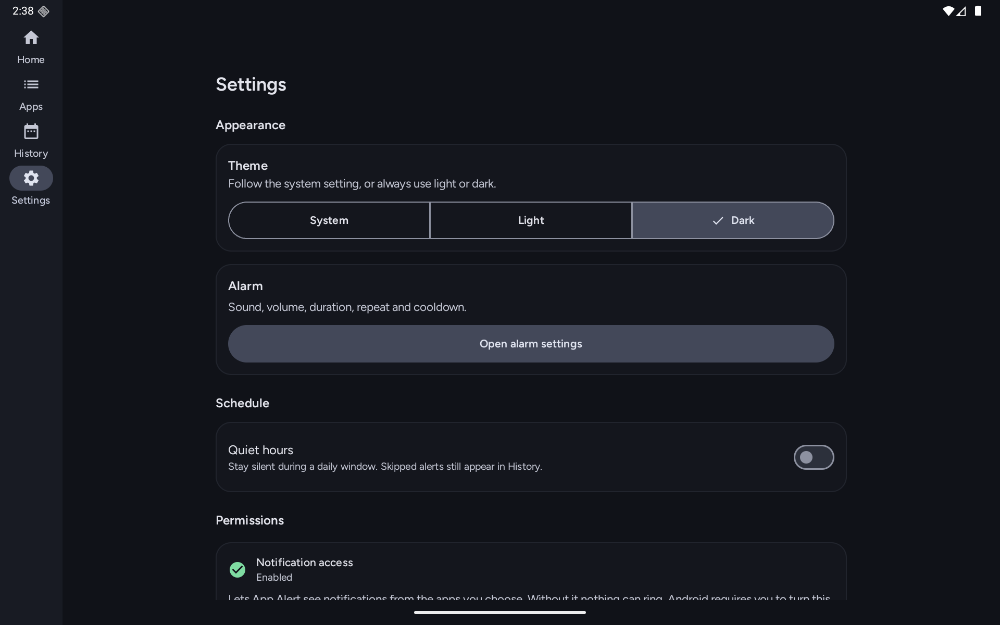

# App Alert

An Android app that plays an alarm when a notification arrives from apps you pick, for the times you can't watch your phone. Everything stays on the device. Message text is only read to apply your filters and is never stored or logged.

Kotlin, Jetpack Compose, Material 3, minSdk 24.

## Features

- Pick which apps trigger the alarm, each with its own sound and optional keyword and category filters
- Custom sound (system ringtone or your own audio file), volume, duration, repeats, vibration
- Quiet hours with weekdays, including windows that cross midnight
- Duplicate detection and a per-app cooldown
- A monitoring status that is only "active" when Android has really bound the listener
- Alert history (outcome only, last 30 days)
- Phone and tablet layouts, with a System / Light / Dark theme switch (Settings > Theme)

## Screenshots

<p>
  
  
  
  
  
</p>

On tablets and landscape the bottom bar becomes a navigation rail and Applications shows a list and detail side by side.

<p>
  
  
</p>
<p>
  
  
</p>

## Run it

Open the project in a recent Android Studio and run the `app` configuration, ideally on a physical device. Android requires you to turn on Notification access yourself (Settings > Notifications > Device & app notifications). The onboarding opens that screen for you.

```bash
./gradlew testDebugUnitTest          # unit tests
./gradlew connectedDebugAndroidTest  # Room, DataStore and UI tests (needs a device)
./gradlew assembleRelease            # R8-shrunk release build
```

## How it works

```text
NotificationListenerService      builds a NotificationEvent, ignores unselected apps
  -> ProcessIncomingNotificationUseCase
       monitoring on > app selected > app enabled > not a summary/ongoing
       > quiet hours > filters > duplicate > cooldown
  -> AlarmPlaybackController     MediaPlayer + vibration, one alarm at a time
  -> history                     outcome only; a failed write never blocks the alarm
```

- Apps are identified by package name.
- Duplicate and cooldown state is kept in memory. After a restart the worst case is one extra alarm, never a missed one.
- Volume is relative to the device's alarm volume. System volume is never changed.
- Every alarm has a bounded length and can be stopped from the app or its notification.

## Architecture

One Gradle module, feature folders, dependencies pointing inward (`presentation -> domain <- data`).

```text
app/            manual DI (AppContainer), navigation
core/           common, designsystem, database, datastore, notifications, audio, permissions, ui
feature/        dashboard, applications, alarm, history, settings, onboarding
                each with domain/, data/, presentation/
```

Each screen has a `UiState`, an `Action`, a `ViewModel`, a stateless `Screen` and a small `Route`. Preferences are in DataStore, history and per-app rules are in Room. Read-modify-write operations are atomic in the repositories.

## Permissions

| Permission | Purpose | Required |
|---|---|---|
| Notification access | See notifications from selected apps | Yes |
| `POST_NOTIFICATIONS` (Android 13+) | Show the Stop notification while ringing | No |
| Do Not Disturb access | Let you allow alarms in DND | No |
| Unrestricted battery use | More reliable on aggressive OEMs | No |
| `VIBRATE` | Vibration | No |

No `QUERY_ALL_PACKAGES` and no storage permission (custom sounds use the document picker).

## Releasing

CI runs unit tests, lint and a release build on every push and pull request. Each push to `main` also publishes a new GitHub Release (`v1.0.<run number>`, marked Latest) with the APK attached. Pushing a version tag builds a signed APK and AAB and publishes a GitHub Release:

```bash
git tag v1.0.0
git push origin v1.0.0
```

Tags with a suffix like `v1.1.0-beta1` become pre-releases. Without signing secrets the release is signed with a throwaway test key and marked as a pre-release.

To sign with your own key, create a keystore and keep it safe (losing it means you can't update the app):

```bash
keytool -genkeypair -v -keystore release.jks -alias appalert \
  -keyalg RSA -keysize 4096 -validity 10000
base64 -w0 release.jks
```

Add these repository secrets: `SIGNING_KEYSTORE_BASE64`, `SIGNING_STORE_PASSWORD`, `SIGNING_KEY_ALIAS`, `SIGNING_KEY_PASSWORD`. Never commit the keystore. Keep each release's `mapping.txt` to decode crash traces.

## Troubleshooting

- **Waiting for Android to connect:** access is on but the service isn't bound. Toggle the notification access off and on, or reopen the app.
- **No sound:** raise the alarm volume and check Do Not Disturb.
- **Stops working after a while on Xiaomi, Huawei, OnePlus or Samsung:** set battery to unrestricted and allow auto-start. See https://dontkillmyapp.com.
- **Custom sound stopped playing:** the file was moved or deleted. The app falls back to the default alarm sound.

## Known limitations

- Playback runs in the app process, not a foreground service.
- UI strings are English only and not yet in `strings.xml`.
- The onboarding step is not restored after process death.

## Contributing

See [CONTRIBUTING.md](CONTRIBUTING.md). Licensed under [MIT](LICENSE).
